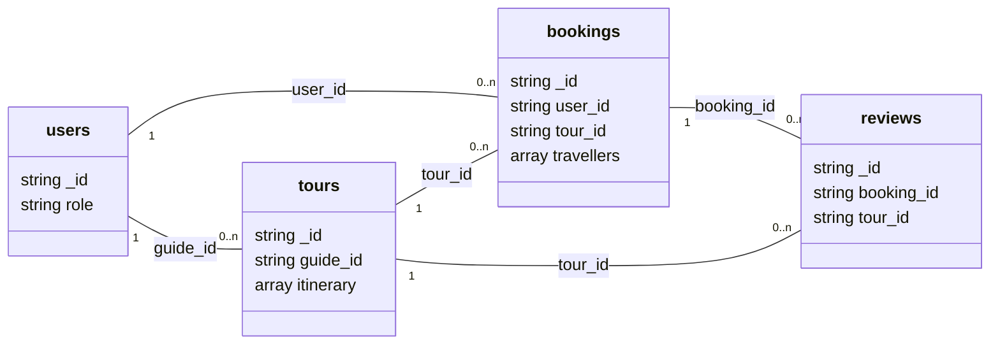

# Travel data generation

Use this function to generate the four JSONBench travel collections without a database:

```python
from json_bench.data import generate_travel_dataset

dataset = generate_travel_dataset(
    scale=0.01,
    seed=23,
    reference_date="2025-11-01",
)
```

## Collection relationships

The diagram shows references between documents. `1` means exactly one;
`0..n` means zero or more. For example, each booking refers to one tour,
while a tour can have zero or more bookings.



Tours reference users whose role is `guide`. Bookings reference ordinary users.
Each review copies the tour ID from its booking. Multiple reviews can reference
the same booking.

`itinerary` and `travellers` are embedded arrays, not separate collections.
Traveller records are not references to user documents. The diagram lists only
identifiers, reference fields, and the two embedded arrays; other fields are omitted.

## API

```python
generate_travel_dataset(
    *, scale: float, seed: int, reference_date: str
) -> dict[str, list[dict]]
```

All three arguments are required and keyword-only.

- `scale`: A finite number of at least 0.01. Booleans are rejected.
- `seed`: An integer used to seed fresh Python and Faker random generators.
- `reference_date`: An ISO date string, such as `2025-11-01`, used instead of today.

The returned dictionary contains these lists, in this order:

| Key | Document count | Count at scale 0.01 |
| --- | --- | --- |
| `users` | `int(1000 * scale)` | 10 |
| `tours` | `int(200 * scale)` | 2 |
| `bookings` | `int(5000 * scale)` | 50 |
| `reviews` | `int(2500 * scale)` | 25 |

Invalid scale values or malformed date strings raise `ValueError`.
The function creates no files and opens no database connections.
Each call returns independent dictionaries and lists.

## Compatibility with JSONBench

The private generator preserves the original [JSONBench](https://github.com/zeNightshade/JSONBench) generation order and
random calls. Faker is pinned to 38.3.0, matching JSONBench's lockfile.
Repeatability requires the same inputs and compatible dependency versions.

The data rules are unchanged:

- Guides and ordinary users share the users collection.
- Tours reference guides. Bookings reference ordinary users and tours.
- Travellers are embedded in bookings, not linked to user documents.
- Reviews reference bookings and copy their tour IDs.
- Dates remain ISO strings. IDs retain their original prefixes and sequence.
- Booking dates are independent of tour dates. Reviews do not require the booking
  to be marked travelled. Multiple reviews can reference the same booking.

Tests compare complete collection hashes with outputs captured from the original
JSONBench generator. The reference file records the source commit, source-file
checksum, Faker version and inputs.

## Memory and loading

All documents are held in memory. Scale 200 produces 1.74 million documents,
including nested travellers and review text, so large datasets can need substantial memory.

The generator returns all documents in memory; it does not stream them.
`notebooks/walkthrough.ipynb` in the checkout loads the same generated dataset
into MongoDB and Couchbase through BONDI. See the [data API](reference/data.md).
