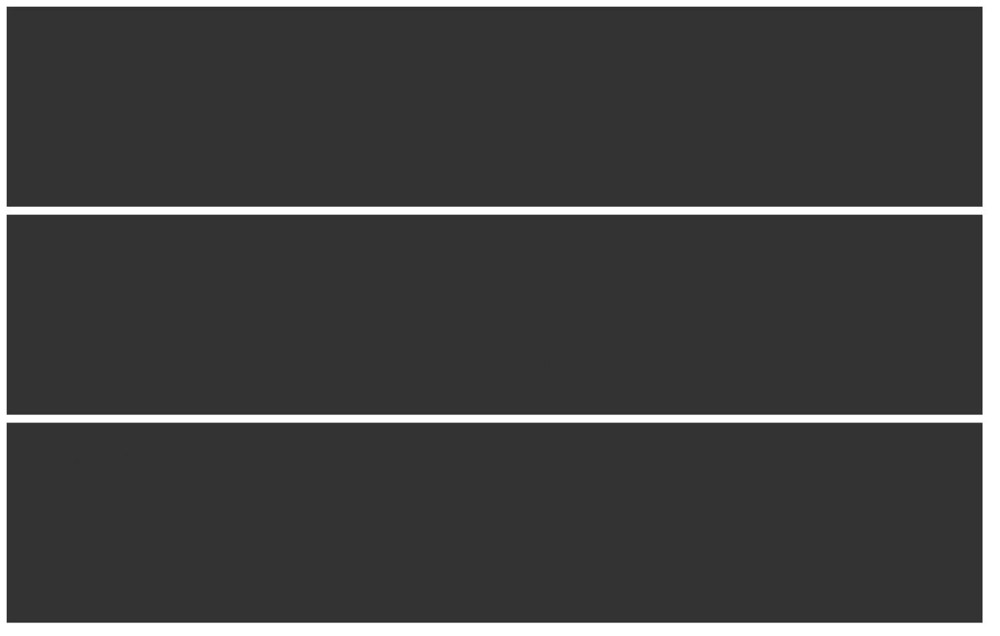

# Architecture

## Overview

The _BONDI JSON Bench_ architecture has three layers. This repository contains the **consumers**
(the CLI, Yanex scripts, notebooks and tests) and the **JSON Bench core API**. The
consumers use the core API to prepare data, run experiments, and analyse results.

**BONDI** is a separate package dependency, installed with the project. It provides
database deployments, data loading, native queries, workloads, and query execution.
The core API builds on these features and adds the benchmark-specific logic.

## Core Components

The core API is implemented as a Python package under `src/json_bench`.
Its functionality is grouped into separate modules, as shown below.

| Component | Responsibility |
| --- | --- |
| `data.py` | Generate travel documents without database or file access |
| `queries.py` | Validate templates and translate them into native BONDI queries |
| `validate.py` | Compare collected grouped query results |
| `indexes.py` | Apply benchmark-specific indexes |
| `experiment.py` | Prepare databases and execute one benchmark run |
| `analysis.py` | Calculate measurement summaries and prepare result cohorts |
| `plotting.py` | Return Matplotlib figures from prepared analysis data |
| `cli.py` | Expand matrices, save state, resume, clean up, and export figures |
| `experiments/` | Yanex adapters, configuration, templates, and index definitions |

BONDI supplies deployments, document loading, query objects, executors, workloads,
and sustained-load generation. JSONBench owns the travel model, template language,
benchmark protocol, and analysis choices.

Both CLI and Yanex call `prepare_databases()` and `run_benchmark()`. Changes to
execution belong there, not in two separate interface implementations. Plotting
functions do not access databases or write files; callers choose how to save them.
