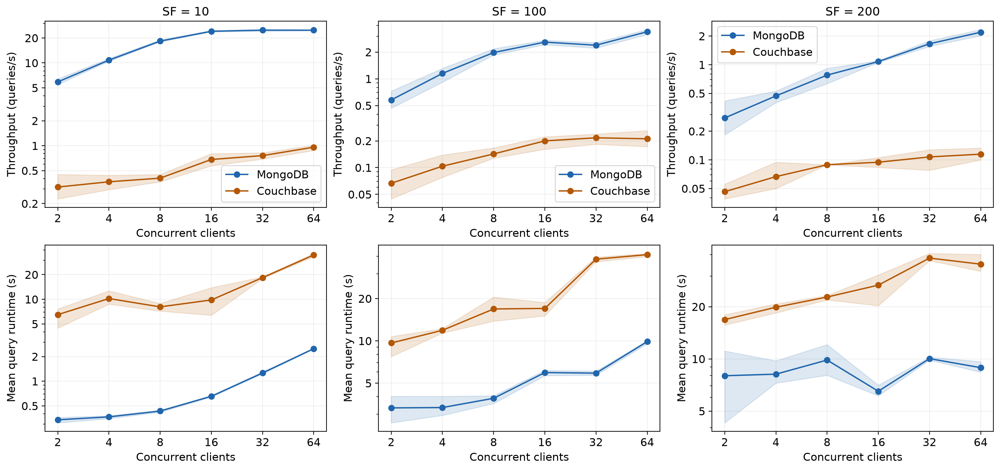
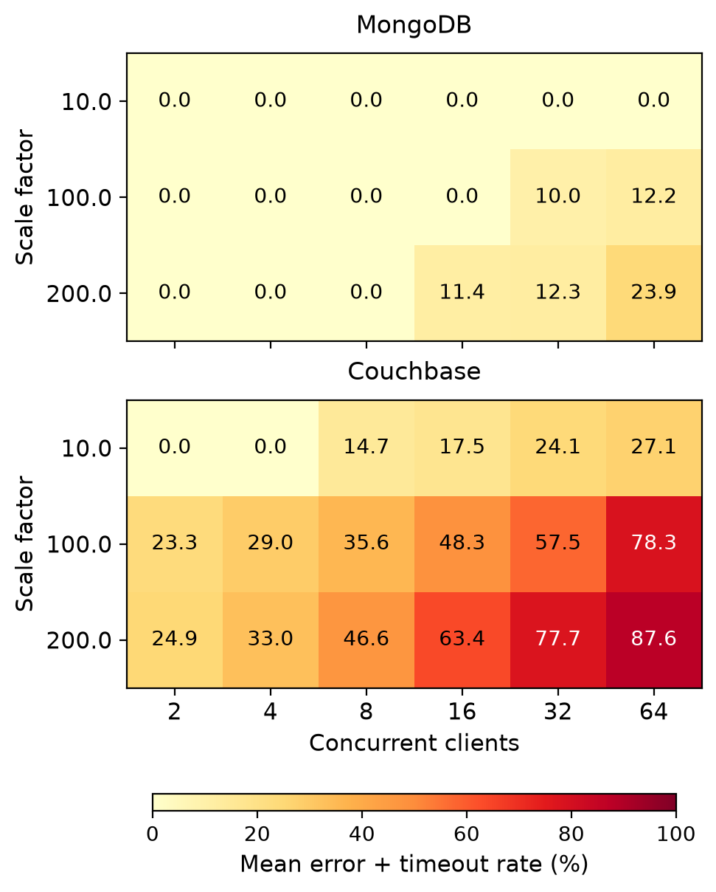
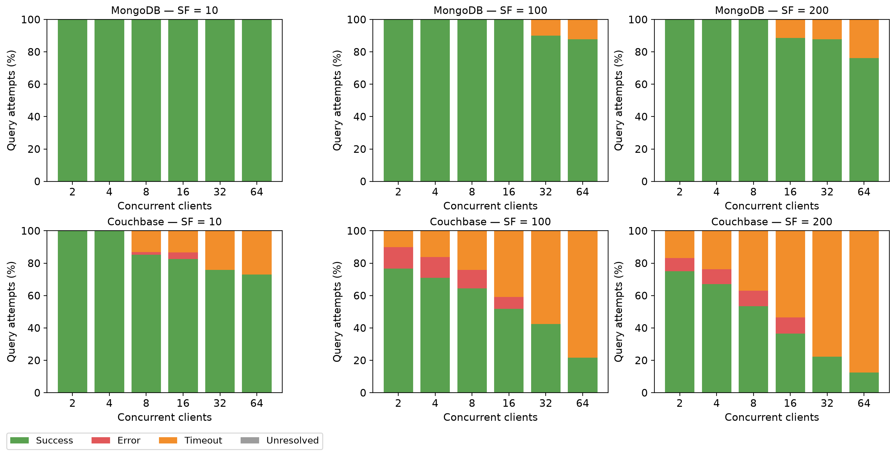
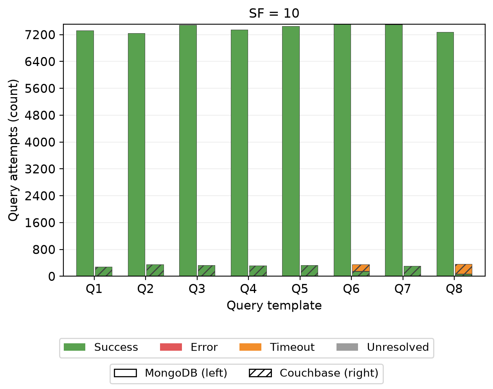
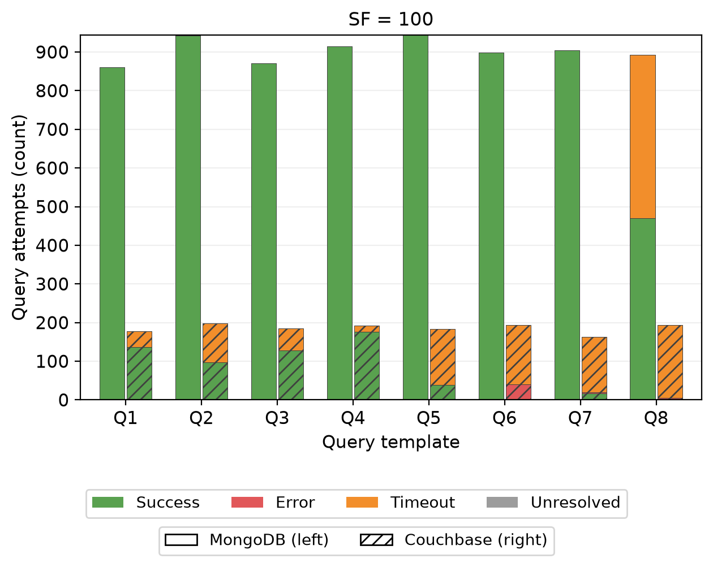
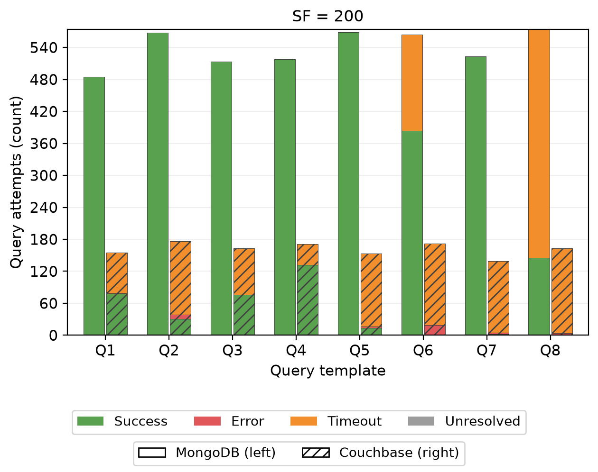
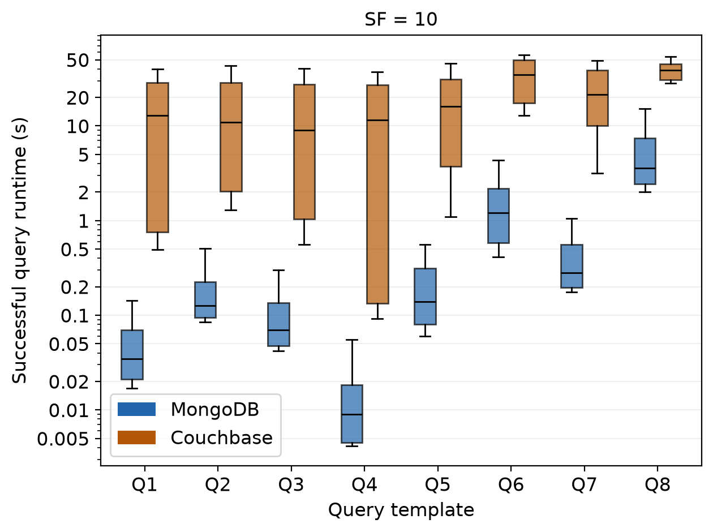
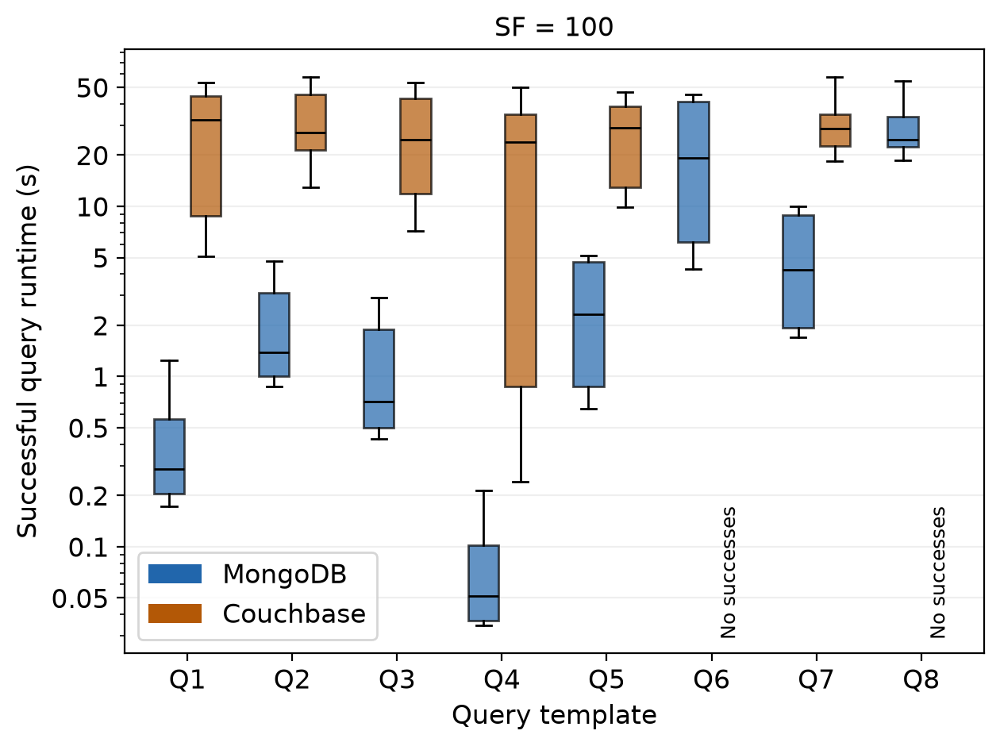
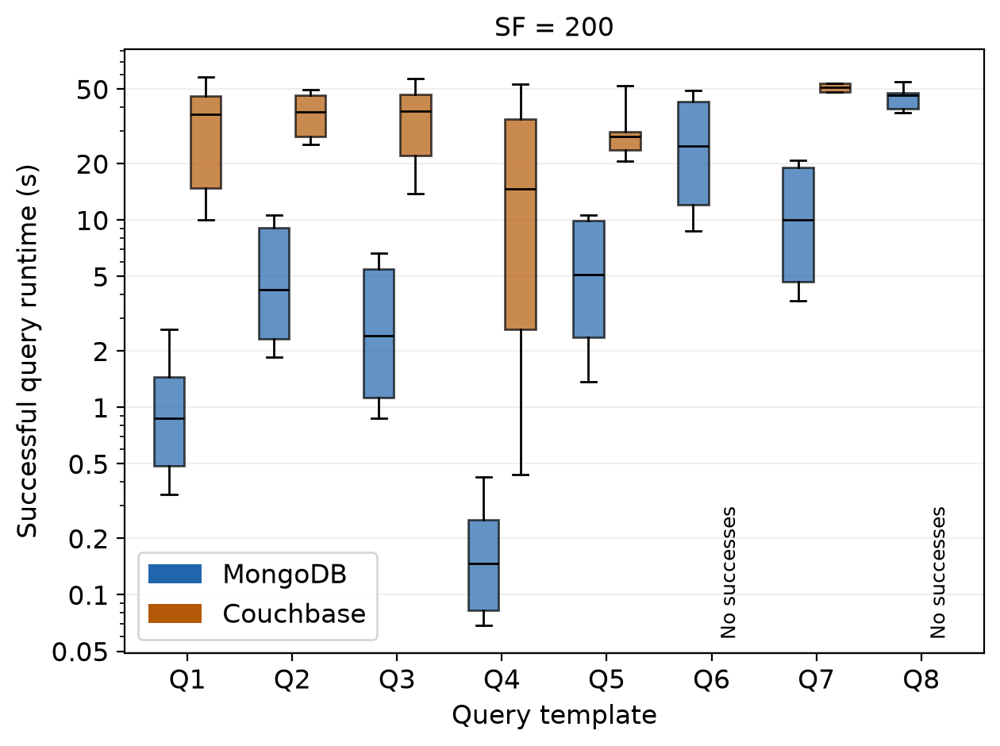

# Results

These figures show the BONDI JSON Bench reproduction of the original JSONBench
experiment. The reproduction compares MongoDB and Couchbase at scale factors
10, 100, and 200, with six client counts from 2 to 64 and three repetitions per
configuration.

Select any figure to open it at full size.

## Throughput and runtime

<figure>
  
  <figcaption>Lines show means across repetitions. Shaded bands show the range across repetitions.</figcaption>
</figure>

## Failures and outcome shares

<figure class="results-heatmap">
  
  <figcaption>Each cell shows the mean share of attempts that ended in an error or a timeout.</figcaption>
</figure>

<figure>
  
  <figcaption>Outcome shares are averaged across runs. The plots distinguish successes, errors, timeouts, and unresolved attempts.</figcaption>
</figure>

## Results by query

### Query outcome counts

Absolute outcome counts pooled across client counts and repetitions.

<figure>
  
  <figcaption>Scale factor 10</figcaption>
</figure>
<figure>
  
  <figcaption>Scale factor 100</figcaption>
</figure>
<figure>
  
  <figcaption>Scale factor 200</figcaption>
</figure>

### Successful query runtimes

Runtime distributions for successful executions, pooled across client counts and repetitions.

<figure>
  
  <figcaption>Scale factor 10</figcaption>
</figure>
<figure>
  
  <figcaption>Scale factor 100</figcaption>
</figure>
<figure>
  
  <figcaption>Scale factor 200</figcaption>
</figure>

## Reproducing the figures

See [Generate figures](cli.md#generate-figures) for the export command and
[Reading the figures](plotting.md) for aggregation and metric details.
